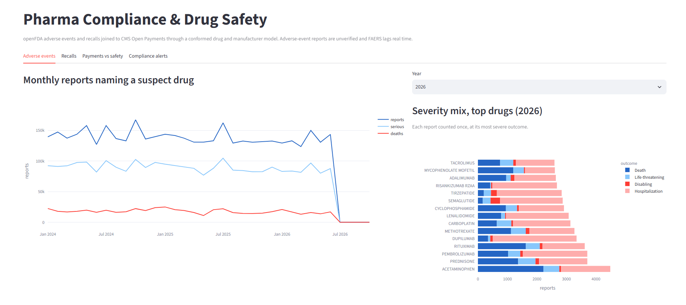
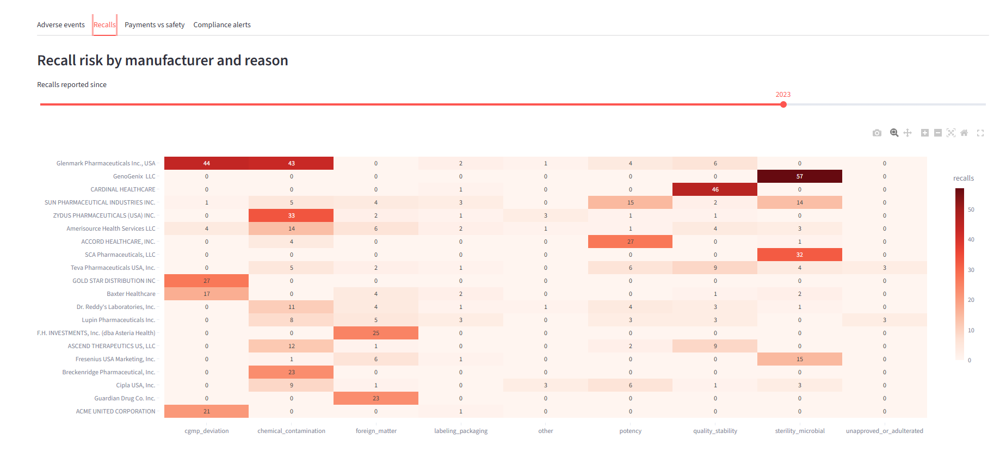
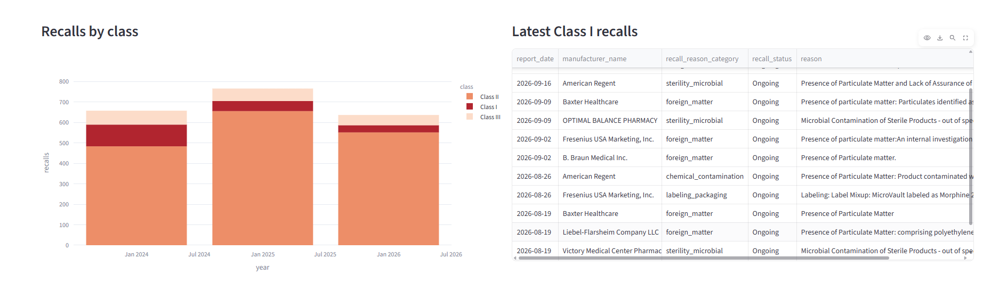
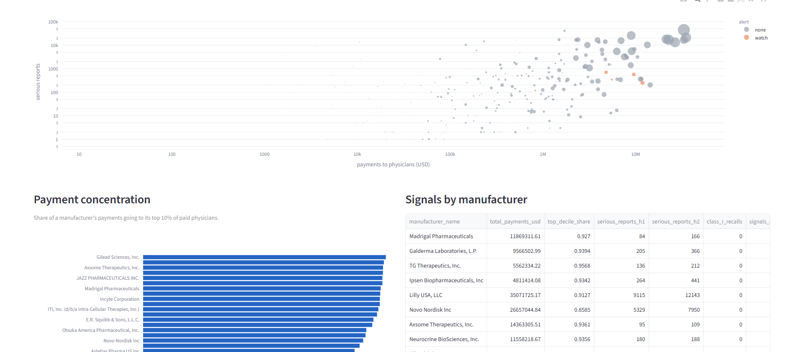

# Pharma Compliance & Drug Safety Warehouse

Is there a relationship between how much a drug manufacturer pays physicians and the safety
signals (adverse events, recalls) tied to its drugs? This project answers that with a dbt
warehouse on Snowflake built from three live US government sources, a rule-based compliance
agent, and a Streamlit dashboard.

| Source | What | Cadence |
| --- | --- | --- |
| openFDA FAERS (`drug/event`) | adverse-event reports, nested drug and reaction arrays | daily |
| openFDA Enforcement (`drug/enforcement`) | recalls with Class I/II/III severity | daily |
| CMS Open Payments | manufacturer-to-physician payments (bulk yearly CSV) | monthly |

Scale in the warehouse: 3.3M adverse-event reports (12.9M report-drug rows, 2024 on), 2,058
classified recalls, 5.0M payments ($576M) to 364K physicians, conformed to 4,415 manufacturers
and 87K drugs.

## Architecture

```text
openFDA x2, CMS CSV
  -> dlt pipelines on GitHub Actions cron (ingestion/)
  -> PHARMA_SOURCE raw tables (dlt state in Snowflake, incremental cursors)
  -> dbt staging      flatten, type, dedupe; one folder per source system
  -> dbt intermediate identity resolution for drugs and manufacturers; recall reason buckets
  -> dbt marts        fact constellation (3 facts, 4 dims) + reporting marts
  -> agent/compliance_watch.py   perceive -> decide -> act, logs alerts + briefs
  -> dashboard/app.py            Streamlit
```

Marts: `fct_adverse_events`, `fct_recalls`, `fct_payments` share `dim_drugs`,
`dim_manufacturers` and `dim_date` (`dim_physicians` joins payments). Reporting tables:
`mart_manufacturer_monthly`, `mart_manufacturer_payment_concentration`,
`mart_compliance_risk_signals`. The three facts are incremental (merge on `_loaded_at`).

## Identity resolution

The hard part: "Pfizer Inc.", "PFIZER LABORATORIES DIV PFIZER INC" and "Wyeth Pharmaceuticals
LLC, a subsidiary of Pfizer" must be one manufacturer, and brand names must roll up to a
generic.

- **Manufacturers** (`int_manufacturer_resolution`), in order: rules (`normalize_firm_name`
  uppercases, strips legal suffixes and generic company words, and rolls "subsidiary of / div
  of / d/b/a X" up to X); a hand-curated alias seed; then Jaro-Winkler fuzzy matching for names
  seen in one source only. A near-match merges only above a strict threshold, because one
  letter apart is often a different company (BETCO / BESTCO). Weaker near-matches are
  reported for human review instead of being merged.
- **Drugs** (`int_drug_dictionary`, `int_drug_resolution`): a brand -> generic dictionary
  learned from the data itself (openFDA's enrichment and the reporter's active-substance
  field, most frequent generic wins), so Ozempic, Wegovy and Rybelsus share one `drug_key`.
- Both resolutions are guarded by singular tests (grain, and full coverage of every raw name).

## Rule-based enrichment (instead of an LLM)

Recall reasons are free text. `macros/classify_recall_reason.sql` buckets them with ordered
regex rules (sterility, chemical contamination, foreign matter, potency, ...), covered by a dbt
unit test; about 98% land in a named bucket. The original design used Snowflake Cortex, which
this account does not have. Rules are also a defensible choice for compliance data: they are
auditable and reproducible. `agent/compliance_watch.py::draft_brief` is a template today and
the one place an LLM would plug in.

## Compliance agent

`mart_compliance_risk_signals` holds four signals per manufacturer (material payer, high
payment concentration, rising serious reports H2 vs H1, Class I recall); the agent reads the
flagged ones, skips what it already alerted on, drafts a brief and logs it to
`agent.compliance_alerts`. Its first four alerts and their false-positive patterns (mostly
new-drug launch ramp-up) are in [docs/agent_review.md](docs/agent_review.md).

## Quality

- 100+ dbt tests (keys, relationships, accepted values), singular tests for resolution grain,
  a unit test for the recall classifier, source freshness per feed.
- `dbt_project_evaluator` runs clean; intentional deviations are documented one by one in
  `pharma_safety/seeds/dbt_project_evaluator_exceptions.csv`.
- Two SCD2 snapshots: `dim_drugs_snapshot` and `compliance_alert_level_snapshot` (when a
  manufacturer escalated).
- GitHub Actions: `dbt-ci.yml` (PRs: parse, slim `state:modified+` build with deferral to the
  last production manifest, evaluator) and `dbt-deploy.yml` (daily: freshness, build, test,
  snapshot, docs, upload manifest). Ingestion runs in separate workflows.

## Dashboard






## Running it

```bash
uv sync
cd pharma_safety && dbt deps && dbt seed && dbt build   # needs the pharma_safety profile
cd .. && uv run python agent/compliance_watch.py --dry-run
uv run streamlit run dashboard/app.py
```

CI secrets: `SNOWFLAKE_ACCOUNT`, `SNOWFLAKE_USER`, `SNOWFLAKE_PASSWORD`, `SNOWFLAKE_WAREHOUSE`
(environment `dbt`); optional variables `DBT_CI_DATABASE`, `DBT_PROD_DATABASE`.

## What I would change at enterprise scale

- Master data governance: drug and manufacturer identities signed off by data stewards, with
  the alias seed replaced by a managed MDM table and the fuzzy-match review queue worked.
- dbt Mesh: a safety team and a commercial-compliance team own their own projects and expose
  contracts (the conformed dims) to each other.
- A semantic layer for a single, shared "safety signal" metric.
- Normalize the rising-reports signal by prescription volume (Medicare Part D) so new launches
  do not trigger it, and load more than 2024 onward for a real baseline.
- Real schema-per-PR CI, and a warehouse role model separate from ingestion.

The original course brief is kept in [docs/project-brief.md](docs/project-brief.md).
